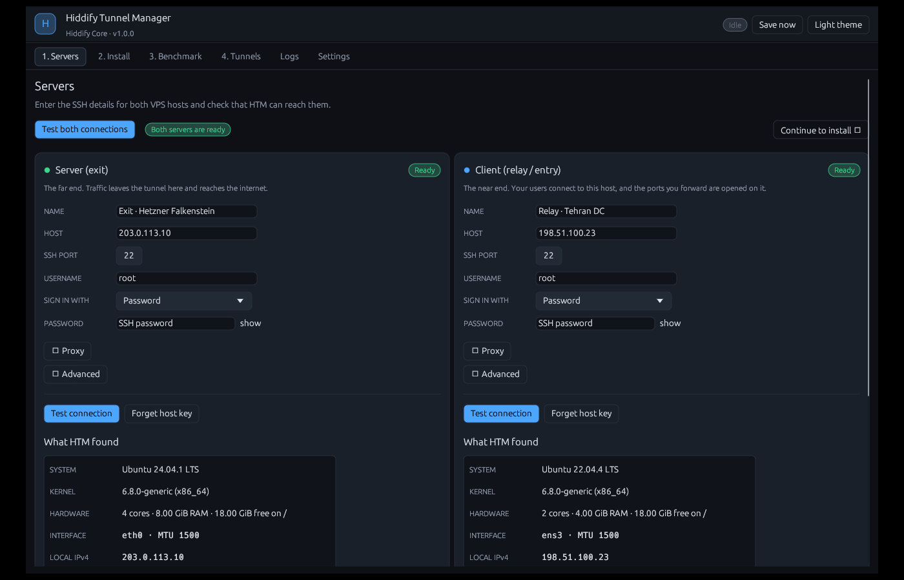
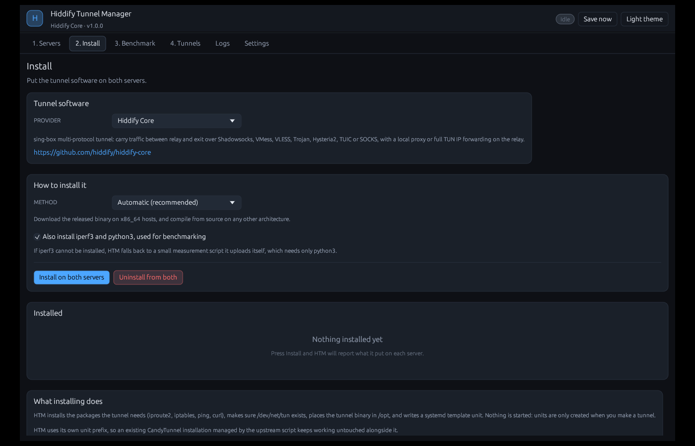
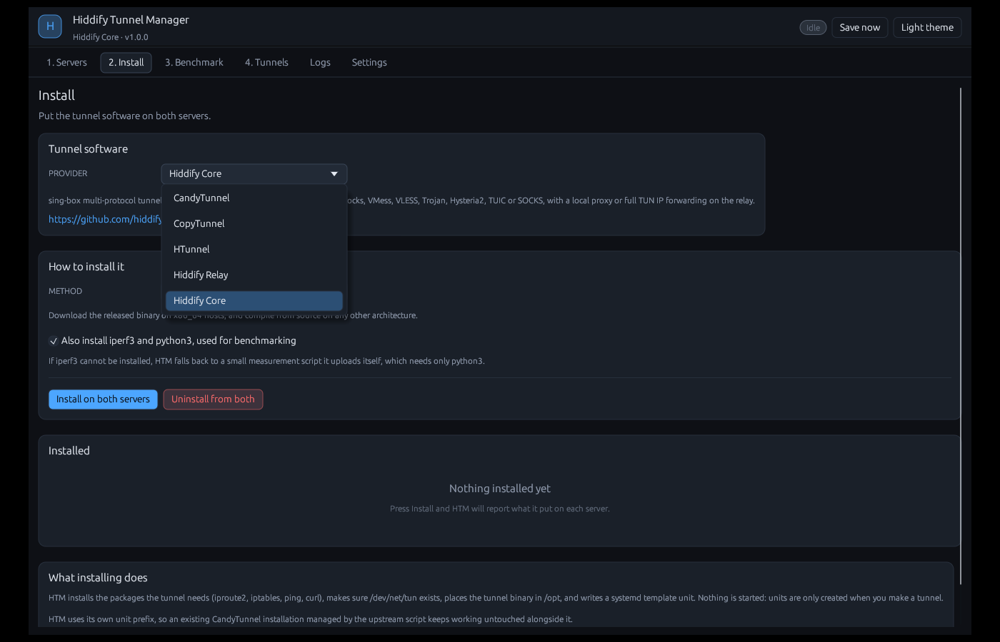
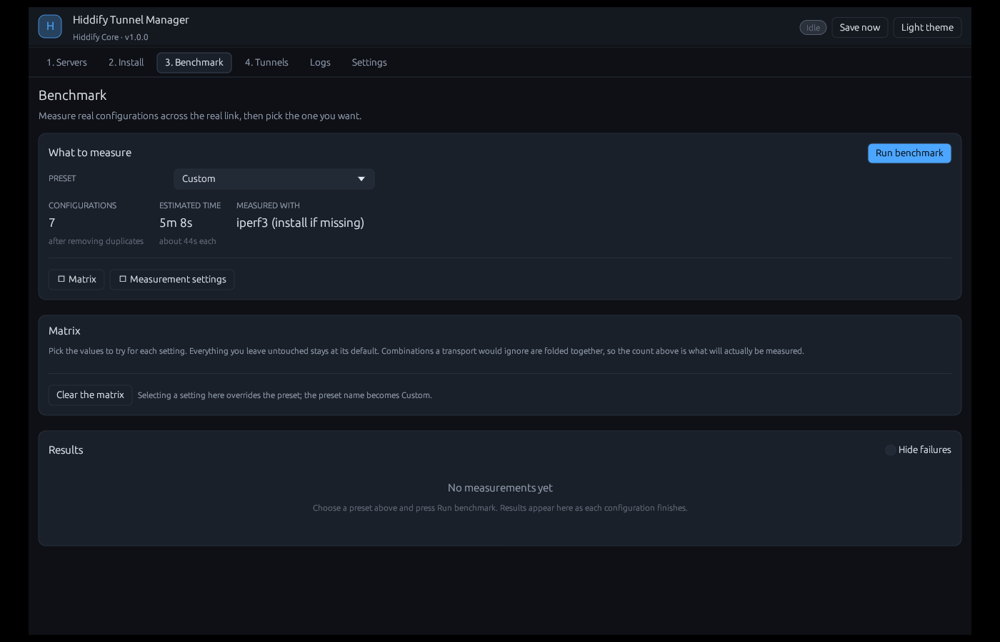
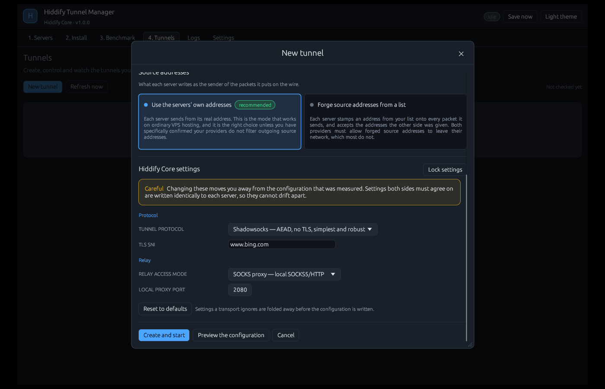
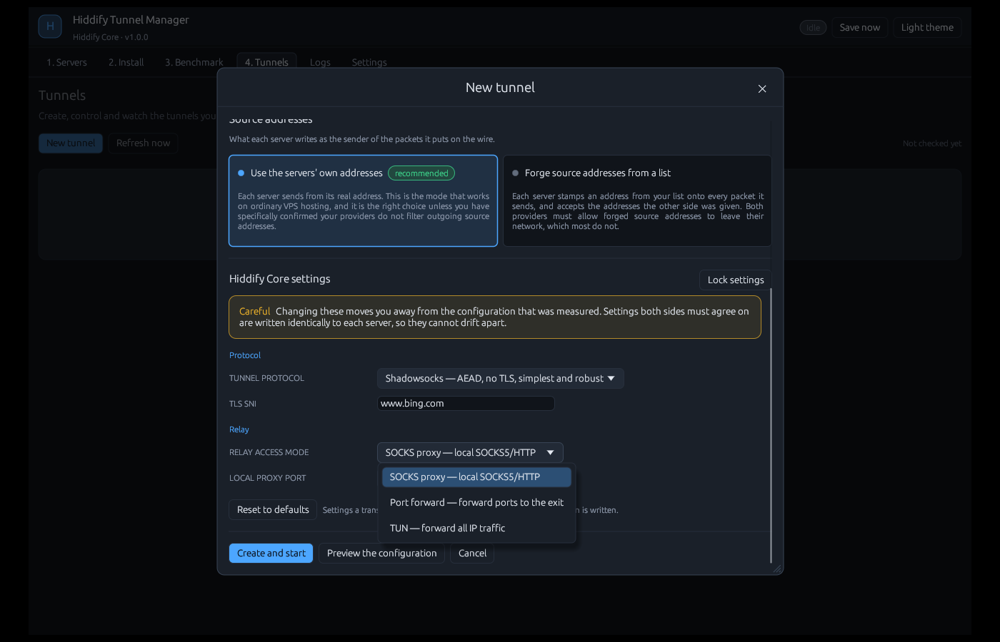

<div align="center">

# HTM — Hiddify Tunnel Manager

**Build, measure and run a tunnel between two servers, without touching a terminal.**

[](https://github.com/Hiddify2/HTM/actions/workflows/release.yml)
[](https://github.com/Hiddify2/HTM/releases/latest)
[](LICENSE)
[](https://www.rust-lang.org/)

Windows · Linux · single binary · no runtime to install

</div>

---

You give HTM SSH access to two servers. It installs the tunnel software on
both, measures every configuration worth trying against the real link between
them, shows you the numbers, and builds the one you pick as a systemd service
you can start, stop and watch from the same window.

No commands to copy. No config files to write. No guessing which protocol your
route actually allows — you measure it.

---

## Contents

- [Download](#download)
- [Screenshots](#screenshots)
- [What it does](#what-it-does)
- [The two source-address modes](#the-two-source-address-modes)
- [What your servers need](#what-your-servers-need)
- [Building from source](#building-from-source)
- [Where your data lives](#where-your-data-lives)
- [Security](#security)
- [Troubleshooting](#troubleshooting)
- [Providers](#providers)
- [The CandyTunnel provider](#the-candytunnel-provider)
- [Adding another tunnel implementation](#adding-another-tunnel-implementation)
- [Licence](#licence)

---

## Download

Grab a binary from the [releases page](https://github.com/Hiddify2/HTM/releases/latest).

| File | Platform |
|------|----------|
| `htm-windows-x86_64.exe` | Windows 10 / 11, 64-bit |
| `htm-linux-x86_64` | Linux, 64-bit, glibc 2.35 or newer |

**Windows** — double-click it. Nothing to install.

**Linux** —

```sh
chmod +x htm-linux-x86_64
./htm-linux-x86_64
```

On a minimal desktop you may also need `libgl1`, `libxkbcommon-x11-0` and
`libssl3`.

Every release ships a matching `.sha256`:

```sh
sha256sum -c htm-linux-x86_64.sha256
```

---

## Screenshots

| | |
|---|---|
| **Servers** — SSH details for both hosts | **Install** — pick a provider and install method |
|  |  |
| **Providers** — five tunnel implementations | **Benchmark** — compare configurations over your route |
|  |  |
| **Tunnel settings** — protocol and relay access mode | **Relay access mode** — SOCKS proxy · port forward · TUN |
|  |  |

---

## What it does

### 1 · Servers

Enter SSH details for two hosts — an **exit** server, where traffic leaves the
tunnel, and a **relay** server, which is what your users connect to.

- Password, private key or SSH agent authentication
- Optional SOCKS5, SOCKS4a or HTTP `CONNECT` proxy, per server, for when your
  own connection to the box is filtered
- sudo handled automatically, with or without a password

Press **Test connection** and HTM reports what it found: distribution,
architecture, CPU, memory, free disk, the interface carrying the default route,
the address on that interface, the address the internet sees, and whether the
host can actually run a tunnel at all. Anything that would block you is listed
in plain words, not left to fail later.

### 2 · Install

HTM installs the tunnel software and everything it depends on. For
[CandyTunnel](https://github.com/Hiddify2/CandyTunnel) that means the published
x86_64 binary where it fits, and a full source build — Rust, CMake and Go,
because the QUIC transport pulls in BoringSSL — where it does not.

It also installs `iproute2`, `iptables`, `ping` and `curl` if they are missing,
using whichever of apt, dnf, yum, pacman, apk or zypper the host has.

### 3 · Benchmark

This is the part that makes HTM worth using.

Pick a preset — *Transport sweep*, *Transports × multiplexing*, *Obfuscation
cost*, *Parallelism & profile*, *Error correction*, *Encryption cost*, or
*Exhaustive* — or build your own matrix by choosing which settings to vary.

For each configuration, HTM:

1. writes both config files onto an isolated, reserved TUN subnet, so a
   benchmark can never disturb a tunnel you already deployed;
2. starts the exit unit, then the relay unit;
3. waits until the link genuinely carries traffic, not merely until systemd
   says `active`;
4. measures ICMP latency and jitter, TCP throughput in **both** directions, and
   UDP jitter and packet loss;
5. tears it all down and moves to the next one.

Nothing is estimated or extrapolated. Every number in the table is what that
configuration actually did over your route, between your two servers.

Results are scored 0–100 against each other, using weights you control — favour
throughput, favour latency, or set the six sliders yourself. Changing the
weights re-scores the table instantly. Every column sorts. Failed
configurations keep the tail of the server journal that explains why.

### 4 · Choose and build

Pick a row, press **Create a tunnel with this**, enter the ports you want
forwarded on the relay, and HTM writes both configurations, installs a systemd
unit on each host, starts them in the right order and waits until the link
answers.

You can preview exactly what will be written to each server before anything is
uploaded.

### 5 · Run it

- Start, stop, restart, enable or disable at boot
- Live throughput with a sparkline, interface counters, round-trip time, uptime,
  memory, restart count
- Read either server's journal, streamed with a cursor so each refresh fetches
  only what is new
- Remove a tunnel completely from both hosts when you are done

---

## The two source-address modes

When you create a tunnel you choose how each server fills in the *source
address* of the packets it sends. This is a genuine either-or with very
different consequences, so HTM asks it directly rather than hiding it behind a
checkbox.

### Normal — use the servers' own addresses

Each server sends from its real address.

This is the mode that works on ordinary VPS hosting. Providers apply egress
filtering (BCP 38) and silently drop packets whose source address does not
belong to the customer, so anything else simply never arrives.

**Choose this unless you have specifically confirmed otherwise.** It is the
default.

### Spoof — forge source addresses from a list

You give HTM a list of IPv4 addresses. Each server stamps one of them onto every
packet it sends, so the traffic appears to come from somewhere else entirely —
which is the point on a network that fingerprints endpoints by address.

HTM splits your list between the two servers, alternating entries:

```
8.8.8.8, 1.1.1.1, 9.9.9.9, 208.67.222.222

  relay sends as   8.8.8.8, 9.9.9.9
  exit  sends as   1.1.1.1, 208.67.222.222
```

The split is shown live as you type, so you never have to guess which server
claims which address.

Two addresses is the minimum: each side needs its own, because each end
identifies its peer partly by the source address it sees, and a shared address
would make the two indistinguishable. Extra addresses become a rotation pool —
and each server is configured to accept *every* address the other one was given,
so rotation can never break the link.

> **Both providers must allow forged source addresses to leave their network.**
> Most do not. If either one filters, the tunnel will not carry a single packet.
> Benchmark this mode before relying on it — that is exactly what the benchmark
> is for.

---

## What your servers need

Both hosts must be Linux with:

| Requirement | Why |
|-------------|-----|
| **systemd as PID 1** | HTM manages tunnels as systemd units |
| **root, or sudo** | raw sockets, TUN devices and unit files all need it |
| **`/dev/net/tun`** | a container must have the TUN device passed through |
| **A supported package manager** | apt, dnf, yum, pacman, apk or zypper |

HTM installs `iproute2`, `iptables`, `ping` and `curl` itself. For benchmarking
it wants `iperf3`, and falls back to a small Python measurement script it
uploads itself when `iperf3` cannot be installed — so a locked-down host can
still be measured.

Published CandyTunnel binaries are x86_64 only. On any other architecture HTM
builds from source instead, which needs roughly 1 GiB of RAM and 2 GiB of disk.

---

## Building from source

You need Rust 1.76 or newer.

```sh
git clone https://github.com/Hiddify2/HTM
cd HiddifyTunnelManager
cargo build --release
```

The binary is `target/release/htm` (`htm.exe` on Windows).

**Windows** needs nothing beyond the Rust MSVC toolchain and the Visual Studio
Build Tools. `libssh2` compiles from vendored C source against WinCNG, so there
is no OpenSSL dependency.

**Linux** needs OpenSSL headers for `libssh2`, plus the usual windowing
development packages:

```sh
# Debian / Ubuntu
sudo apt install build-essential pkg-config libssl-dev \
                 libx11-dev libxcursor-dev libxrandr-dev libxi-dev \
                 libgl1-mesa-dev libwayland-dev libxkbcommon-dev

# Fedora
sudo dnf install gcc gcc-c++ make pkgconf-pkg-config openssl-devel \
                 libX11-devel libXcursor-devel libXrandr-devel libXi-devel \
                 mesa-libGL-devel wayland-devel libxkbcommon-devel
```

Run the tests:

```sh
cargo test
```

They cover the places where being wrong is silent: shell quoting, port list
parsing, `ping` output from both iputils and busybox, iperf3 JSON in both its
shapes, TUN slot allocation, benchmark scoring, matrix expansion and
de-duplication, config rendering for both sides and both address modes, vault
round-trips including tamper detection, and `systemctl show` parsing.

---

## Where your data lives

| Platform | Folder |
|----------|--------|
| Windows | `%APPDATA%\HTM` |
| Linux | `~/.config/HTM` |

Set `HTM_HOME` to keep it somewhere else — a removable drive, for instance.

```
state.json         servers, tunnels, benchmark history, preferences
secrets.bin        SSH passwords, encrypted
device.key         key used when no master password is set
known_hosts.json   pinned SSH host keys
htm.log            application log
```

`state.json` never contains a password. It records only *whether* one exists.

---

## Security

### Credentials

`secrets.bin` is encrypted with AES-256-GCM. The key comes from one of two
places, and HTM tells you which is in use, in these terms, on the Settings tab:

- **A master password** you set yourself, stretched with Argon2id. Without it
  the file is useless to anyone, including someone who copies it.
- **`device.key`** — 32 random bytes written with owner-only permissions. This
  stops the file being useful on another machine, but anyone who can read your
  user profile can read both.

A vault that cannot be opened is **never overwritten**, so a forgotten password
costs you nothing but the typing.

### Host keys

HTM keeps its own pin file rather than reading or writing your OpenSSH
`known_hosts`. The first connection to a server shows the fingerprint and asks;
after that, a key that changes stops the connection until you explicitly approve
the new one, with a dialog that says what a changed key means.

### On the servers

Configuration files hold the tunnel's pre-shared key, so they are written
`root:root` mode `0600`, into a directory that is `0750`. The shared key is
never displayed in the interface and never written to the application log.

---

## Troubleshooting

**"No root access."**
Log in as `root`, or give the account sudo rights and fill in the sudo password
field. HTM checks `sudo -n` first and only asks for a password if it has to.

**"/dev/net/tun is missing."**
The host or container is not exposing the TUN device. On an OpenVZ or LXC
container, the provider has to enable it — you cannot fix this from inside.

**"Could not reach the GitHub release API."**
The *server* has no outbound HTTPS, or GitHub is blocked from it. Switch the
install method to *Build from source*, or place the binary at
`/opt/candytunnel/candy-tunnel` yourself.

**Every benchmark configuration fails.**
Almost always the two servers cannot reach each other at all. Check the exit
node's firewall, and check that both providers allow raw IP traffic. Set *Stop
after N failures* in the measurement settings so a hopeless run gives up early
instead of spending an hour proving the same point.

**The tunnel starts but carries nothing.**
Open the Logs tab and read the relay's journal. If you are using the spoof mode,
try the normal mode first — a provider that filters forged source addresses
produces exactly this symptom.

**A source build runs out of memory.**
Linking on a 512 MB instance usually fails. Add swap, or use a host where the
prebuilt binary fits.

---

## Providers

HTM ships four tunnel implementations. They do not all work the same way, so
each declares a **model** that tells HTM how to deploy, test and (where it
applies) benchmark it:

| Provider | Model | What it is | Benchmark sweeps |
|----------|-------|------------|------------------|
| **CandyTunnel** | point-to-point TUN | IP-spoofing TUN tunnel, seven transports | transports, mux, FEC, … |
| **CopyTunnel** | point-to-point TUN | Encrypted layer-3 TUN tunnel over UDP, six ciphers | ciphers, obfuscation |
| **HTunnel** | SOCKS proxy | Local SOCKS5 proxy with fake-source-UDP downlink | parallel tunnels |
| **Hiddify Core** | SOCKS proxy | sing-box multi-protocol tunnel (SS, VMess, VLESS, Trojan, Hysteria2, TUIC, SOCKS); SOCKS proxy, port forward or full TUN on the relay | protocols |
| **Hiddify Relay** | relay forward | Port forwarder to an upstream, six methods | methods |

**Every provider is benchmarkable.** The TUN providers are measured across the
point-to-point TUN link (ICMP + iperf3). The others have no such link, so HTM
measures the relay→exit path with its bundled probe: a port-forward provider is
measured to a forwarded port on the relay, and a SOCKS-proxy provider through
its proxy, with latency taken from the TCP-connect round-trip. Each provider's
benchmark sweeps the dimension that matters for it — which is how you find the
fastest protocol, cipher or relay method over your route.

- **Point-to-point TUN** providers join the relay and the exit with a `/30` TUN
  link. Readiness is an ICMP echo across it, and the throughput benchmark
  measures over it. These are the providers the Benchmark tab works with.
- **SOCKS proxy** providers (HTunnel, Hiddify Core) expose a local SOCKS5 port
  on the relay — or, for Hiddify Core, a **port forward** to the exit or a TUN
  device that forwards all of the relay's IP traffic — instead of a
  point-to-point TUN link. The relay access mode (SOCKS proxy / port forward /
  TUN) is chosen per tunnel in the wizard. Readiness is the relay's inbound and
  the exit's protocol port actually listening. **Hiddify Core**
  carries traffic over any of sing-box's protocols — Shadowsocks, VMess, VLESS,
  Trojan, Hysteria2, TUIC or SOCKS — with the exit running the protocol server
  and the relay the client; it is the way to get many protocols at once.
  HTunnel's uplink rides an upstream SOCKS5 proxy you point it at; HTM does not
  stand that proxy up.
- The **Benchmark** tab works for every provider. For a point-to-point TUN
  provider it measures across the TUN link; for the others it measures the
  relay→exit path through a forwarded port or the SOCKS proxy.
- **Relay forward** providers (Hiddify Relay) forward a set of ports to an
  upstream main server. HTM manages the relay (and, for the WST method, the
  upstream too); the other five methods leave the upstream an unchanged
  destination. The six methods are **IP-Tables**, **GOST**, **Dokodemo-Door**
  (Xray), **HAProxy**, **Socat** and **WST** (wstunnel).

Create any of them from the wizard. The Benchmark tab applies only to the
point-to-point TUN providers; for the others, build the tunnel directly.

## The CandyTunnel provider

CandyTunnel ships three binaries. HTM installs and runs only the unified
`candy-tunnel` one. The separate `server` binary prompts for a license password
on standard input and verifies it against a remote service, which cannot work
under systemd; upstream's own unit file uses the unified binary for the same
reason.

HTM also namespaces its units as `htm-candytunnel@<name>.service`, so an
existing CandyTunnel installation managed by upstream's `candy-manager.sh` keeps
working untouched alongside it.

All seven transports are supported and benchmarkable: `udp`, `icmp`, `proto58`,
`tcp`, `quic`, `ipip` and `gre` — along with multiplexing, XOR forward error
correction, ChaCha20 encryption, packet padding, TTL jitter, fake TLS headers,
random DSCP marking, port shuffling, parallel tunnels and the three performance
profiles.

---

## Adding another tunnel implementation

HTM is not built around CandyTunnel. Every screen works against a
`TunnelProvider` trait and a dynamically-typed settings map, so the benchmark
matrix, the results table, the deployment flow and the systemd controls all work
for a new provider without being touched.

Adding one means writing a module and adding a line to the registry. See
**[docs/PROVIDERS.md](docs/PROVIDERS.md)**.

---

## Documentation

- **[docs/USAGE.md](docs/USAGE.md)** — a walk through a first run
- **[docs/ARCHITECTURE.md](docs/ARCHITECTURE.md)** — how the pieces fit together, and why
- **[docs/PROVIDERS.md](docs/PROVIDERS.md)** — adding a tunnel implementation

---

## Licence

MIT. See [LICENSE](LICENSE).
